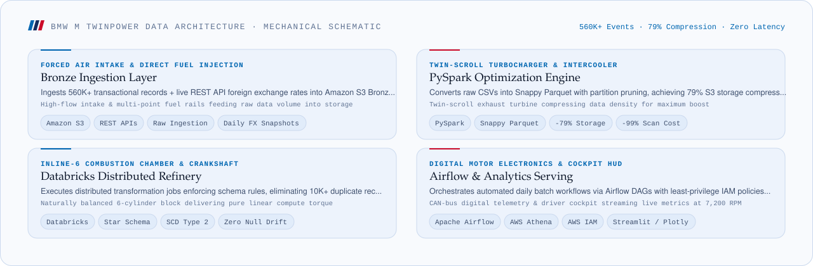
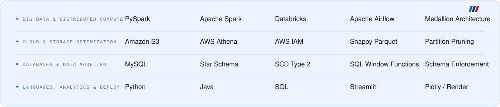

<picture>
  <source media="(prefers-color-scheme: dark)" srcset="./assets/hero-dark.svg">
  
</picture>

**[Portfolio](https://github.com/ritwik-byt/portfolio)** &nbsp;·&nbsp; [Resume](./assets/Ritwik_Ala_Resume.pdf) &nbsp;·&nbsp; [LinkedIn](https://www.linkedin.com/in/avv-ritwik-b90046382/) &nbsp;·&nbsp; [LeetCode](https://leetcode.com/u/AlaRitwik/) &nbsp;·&nbsp; [Email](mailto:alaritwik@gmail.com)

 

Computer Science undergraduate specializing in **Data Analytics** at **VIT-AP** (CGPA: 8.68/10) and **AWS Certified Data Engineer – Associate**. I architect distributed cloud data pipelines and analytical lakehouses: orchestrating **PySpark** batch transformations in **Databricks**, enforcing strict schema rules and Star Schema dimensional modeling, and tuning **Snappy Parquet** storage for a **79% footprint reduction** and **99% Athena scan cost savings**. Seeking a **Data Engineering Internship** to build fault-tolerant, high-torque data platforms.

### BMW M TwinPower Data Architecture

<picture>
  <source media="(prefers-color-scheme: dark)" srcset="./assets/engine-telemetry-dark.svg">
  
</picture>

 

### Featured Systems

<a href="https://ecommerce-lakehouse-ahdfgrhrsgvv8u4hn4z7sn.streamlit.app/"><picture><source media="(prefers-color-scheme: dark)" srcset="./assets/lakehouse-dark.svg"></picture></a>&nbsp;<a href="https://trading-analytics-dashboard-bw5o.onrender.com"><picture><source media="(prefers-color-scheme: dark)" srcset="./assets/trading-dark.svg"></picture></a>
<a href="https://github.com/ritwik-byt/ecommerce-lakehouse"><picture><source media="(prefers-color-scheme: dark)" srcset="./assets/fxe-dark.svg"></picture></a>&nbsp;<a href="https://github.com/ritwik-byt/ecommerce-lakehouse"><picture><source media="(prefers-color-scheme: dark)" srcset="./assets/iam-dark.svg"></picture></a>

### Toolkit

<picture>
  <source media="(prefers-color-scheme: dark)" srcset="./assets/toolkit-dark.svg">
  
</picture>

Off the clock: BMW M Performance engineering, twin-scroll turbochargers, and the timeless mechanical balance of a straight-six engine.
